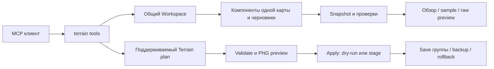

# TERRAIN: the device and operation of the module

TERRAIN combines supported surface editing and native map component diagnostics. It lives in `src/modules/terrain/`, connects to a shared MCP server, and uses `Workspace` with the same drafts, SHA checks, and transactions as Data/Map/Placement.

The addition from `SC2_Surface_Toolkit_SC2GameData.zip` is in `src/modules/terrain/surface/`. It extends the existing TERRAIN with ten `terrain.surface.*` tools. A separate server and a second set of workspace files are not created.

On October 19, the missing public ModKit tools are connected: patency masks and pouring, raw pathing/creep, fluff, vertex-color values, native HRDT, palettes and transfer/extension of qualified ramps. `terrain.navigation.preview`00 uses efficient footprint objects from Data/CASC and stores PNG. Mass decor and height binding are available as `terrain.decorate` and `terrain.objects.snap` through our Placement. Detailed table, examples and limitations: [ModKit integration](MODKIT_INTEGRATION.md#расширение-terrain--19-октября).

## The main commands of surface creation

| The challenge | The team for Codex |
| --- | --- |
| Create relief and distribute materials | `terrain.generate`, `terrain.landscape.plan` |
| Paint with the selected texture | `terrain.paint` |
| Mix textures | `terrain.blend`; default strength 0.5 retains the same texture |
| Slides, irregularities, alignment and smoothing | `terrain.mountain`, `terrain.valley`, `terrain.plan` with `height.raise/lower/noise/smooth/flatten/slope` |
| Hide the soil with cages or areas | `terrain.hide` |
| Restore the soil | `terrain.show` |
| See the hidden cells. | `terrain.visibility.inspect`, `terrain.preview` with `mode:"visibility"` |
| Draw/erase the prohibition of passage or construction | `terrain.pathing.paint`, `terrain.pathing.fill` |
| Check static permeability and get PNG | `terrain.navigation.preview` |
| Scatter the decor on the filters / tie objects to the relief | `terrain.decorate`, `terrain.objects.snap` |
| Select and transfer the native ramp from the donor | `terrain.ramp.fit`, operation `ramp.template` in `terrain.modkit.plan_file` |

These commands create a true stored Terrain plan. `terrain.apply` with `dryRun:false, stage:true` and `terrain.save` with `dryRun:false` record changes. `save` also has dry-run by default.

### Hiding the ground

These are holes/black patches on the map. The `p.SC2Map` provided from Editor 5.0.17.98310 found 24 cells with the `0x06` flag; the normal soil has `0x02`, the holes under the cliff meshes are `0x03`. The brush changes only the concealing bit of `0x04` to `t3CellFlags` v102 and retains the remaining bits, height, texture weights and cliff/ramp geometry.

```json
{"tool":"terrain.hide","arguments":{"cells":[{"x":72,"y":62},{"x":73,"y":62}]}}
{"tool":"terrain.show","arguments":{"area":{"type":"rectangle","minX":72,"minY":62,"maxX":76,"maxY":66}}}
```

`cells` is an entire native cell indices; `area` is a world-space region with a choice of cell centers. Exactly one of these options is required. Implementation is limited to a dimensionally consistent LFCT v102; untested versions are explicitly denied. Operations are available in `terrain.plan` as `surface.hide`/`surface.show`. Hide/Restore ground, Blend textures, Uneven ground and preview concealment are added to the GUI.

Once hidden, ground sampling shows `hidden:true`; scatter and snap do not place objects on hidden ground. Cliff models and objects remain separate geometries. The passability and navigation mesh are not recalculated with this brush.

2026-10-11: The user visually checked and confirmed the operation of two MCP-authored packed copies of `p.SC2Map`: repair 24 cells and add 16 hidden cells.This is a user visual verification of this scenario, not an automatic proof of the entire Editor/runtime. MPQ reopen checks each; ten regressions include real MCP paint/blend/height-noise/hide/show → entry stage/save.

## What is it?

| Part part | Files. | The challenge |
| --- | --- | --- |
| Existing Terrain | `document.ts`, `operations.ts`, `workspace.ts` | Decoding supported versions, creating a plan, synchronizing permitted changes, stage/save/rollback |
| Recipes | `recipes.ts`, `xmlRecipe.ts`, `geometry.ts` | Seeded landscapes, areas, brushes and strict XML DSL |
| Water and light | `waterCatalog.ts`, `lighting.ts` | Limited native profiles WATR/CWater and CTerrain/CLight |
| Preview | `preview.ts` | Diagnostic PNG according to plan |
| Surface Toolkit | `surface/format/`, `surface/core/` | Source codecs, snapshot, raw samples, structural checks, pure byte previews and directory links |
| Host adapter | `surface/workspace.ts` | One selected card, read disk/draft through shared Workspace, check re-read |
| MCP | `tools.ts`, `surface/tools.ts` | Login Schemes, Registration, Response Limitations and Tool Errors |



## It already works.

| Opportunity | The result |
| --- | --- |
| Review | Sizes, versions, components, counts, parsed/partial/opaque/ambiguous/invalid statuses |
| Height. | Existing world-space tools and selected raw HMAP base/adjustment/mask samples |
| Textures | Direct paint/blend commands, palette and brushes; raw MASK returns eight weights 0..15 |
| relief | Raise/lower/set/flatten/noise/smooth, limited seeded styles and feature recipes |
| Water. | Existing flat v110 rectangles on a grid of 8 cells and CWater states; complex bodies are saved without editing |
| Light | Existing binding CTerrain and supported CLight fields |
| Placement | Scatter, ground binding and joint surface/object plan |
| Native analysis | Cliff/ramp metadata, HRDT/VTCL/envelope inspection and raw bytes with obvious unknowns |
| Catalogs | Authored XML records, parent, processing instructions `<?token ...?>`, links, sparse CliffHeights, symbolic HeightCodes |
| Conservation | Only existing Terrain-supported plan: stale guards, group recording, backup and rollback |

Diagnosis is available even where an existing Terrain writer fails because of an unknown version. Being able to read raw bytes does not mean being allowed to write down an arbitrary format.

## New teams

The `directory` surface commands have a path of one card relative to `SC2_UI_ROOT`; the empty string selects the root; the bypass of the nested card folders is not performed. `component` is the name of the file from the inventory of this card.

| Team team. | Entry and appointment |
| --- | --- |
| `terrain.surface.overview` | `directory`, `maxChars` 128.12000; compact overview |
| `terrain.surface.components` | `offset`, `limit` 1.50; component list pages |
| `terrain.surface.component.inspect` | `component`, optional `section`, `offset`, `limit` 1..20 |
| `terrain.surface.height.sample` | Integer `x`,`y` in HMAP grid; raw and two candidate formulas world Z |
| `terrain.surface.texture.sample` | Integer `x`,`y` in the MASK pixel grid; eight nibble weights |
| `terrain.surface.paint.sample` | `layer: pathing/creep`, integer physical `x`,`y` in a 512×512 grid |
| `terrain.surface.bytes` | `component`, `offset`, `length` 0.4096; limited hex fragment |
| `terrain.surface.validate` | Structural and limited interlayer inspections |
| `terrain.surface.plan.cell` | One raw/parameter edit in memory, changed ranges and dirty dependencies |
| `terrain.surface.catalog.inspect` | Workspace-relative `file`, `id`/`type` filters, pages and explicit `bindings` for single-pass token preview |

All ten commands have `readOnlyHint:true`. Errors return as `isError:true`. The answer is limited to 32,000 characters; overflow gives `OUTPUT_BUDGET`. A small overview is marked `TRUNCATED`. The symbols are not declared model tokens.

Snapshot contains SHA-256 revision, selected folder, and a list of staged files. Before answering, the observed files and inventory are re-checked. The change gives `SURFACE_CHANGED_DURING_READ`. Absolute paths, traversal, symlink paths and case collisions are rejected; limits on the number of files and bytes apply. This is checking the observed read set, not blocking external processes from further changes.

## Examples of reading

```json
{"tool":"terrain.surface.overview","arguments":{"directory":"maps/Test","maxChars":6000}}
{"tool":"terrain.surface.component.inspect","arguments":{"directory":"maps/Test","component":"t3Terrain.xml","section":"ramps","limit":5}}
{"tool":"terrain.surface.height.sample","arguments":{"directory":"maps/Test","x":12,"y":8}}
{"tool":"terrain.surface.paint.sample","arguments":{"directory":"maps/Test","layer":"pathing","x":12,"y":8}}
```

`height.sample` here uses vertex indices; `terrain.sample` of the existing API uses world coordinates. MASK pixels and physical painted grid also have separate domains.

```json
{"tool":"terrain.surface.plan.cell","arguments":{"directory":"maps/Test","edit":{"kind":"height-raw","channel":"heightAdjustments","x":12,"y":8,"value":512}}}
```

The preview contains modified byte ranges, `dirtyDependencies`, `requiresEditorRoundTrip:true`, and `engineValidated:false`. It does not stage data, does not create `planId`, and is not transmitted to `terrain.apply`. Five species are `height-raw`, `texture-weight`, `painted-raw`, `vertex-byte`, `terrain-parameter`.

## How the supported recording is executed

1. Select a map and read `terrain.inspect`, `terrain.capabilities`, palette and necessary samples.
2. Make `terrain.plan`, `terrain.generate`, `terrain.road`/`terrain.river`/`terrain.lake` and other feature tools, `terrain.recipe.plan`, `terrain.water.plan` or lighting plan.
3. Check the returned `planId`, limitations, diff and `terrain.preview`/`terrain.validate`.
4. Call `terrain.apply` first with `dryRun:true`; for stage, explicitly `dryRun:false, stage:true`.
5. Save the entire group via `terrain.save` or `modkit.save`; cancel via discard, restore the saved result through an available rollback.

Exact apply/save schema: [Terrain API](TERRAIN_MCP.md). Height writers require supported sync data and unit scale; native geometry is protected. Toolkit does not change this profile or enter a direct file entry.

## GameData and Origins

Catalog inspection reads the actual XML bytes of the work project, indicates the path and SHA-256, stores `<?token ...?>` and initial values.

```json
{"tool":"terrain.surface.catalog.inspect","arguments":{"file":"maps/Test/Base.SC2Data/GameData/CliffMeshData.xml","id":"CliffNatural0","bindings":{"id":"CliffNatural0"},"limit":5}}
```

Supported links for analysis: Terrain → TerrainTex → DDS/PhysicsMaterial/foliage; Terrain → Cliff → CliffMesh; Terrain → Tile → hardTile.bin/M3; CWater → shoreline Model. `bindings`00 is set by the query owner; substitution is done once, the original value is stored, unknown tokens remain unsolved.

The tool does not combine inheritance/defaults/dependency overrides, does not confirm assets and does not open CASC. Named defaults, missing indexes, empty values and zeros retain differences. HeightCodes remain letter strings; the display of letters in height and orientation are unknown.

For a limited report on XML already extracted:

```powershell
npm run build
npm run terrain:catalog:scan -- --root "K:\ExtractedGameData" --out "K:\Reports\terrain-catalogs.json"
```

Scanner does not overwrite output, report errors/skips, follow symlinks, and is not CASC extractor. 35 SC2GameData observations from the archive are used only as reconstructed regression excerpts; this is not the current full game dump. [Origin of source materials](../src/modules/terrain/surface/NOTICE.md)00.

## Unknown formats and further work

- HMAP at `scaleZ != 1`: formulas from reviewed sources diverge; `worldZ:null` and candidates show conflict.
- SMAP v102: Toolkit does not select planar/interleaved by heuristic and returns ambiguous without an explicit profile.The existing Terrain writer retains its limited corpus profile.
- WATR bodies/shorelines/waves and HRDT string framing/mesh generation do not become a general writer.
- Painted bytes, CellFlags, and CellAttribute are not equal to finite passability; `passable:null` remains pronounced.
- Readers of `terrain.surface.*` do not create cliffs/ramps or rearrange engine pathing themselves, but record the existing `terrain.cliff.*`/`terrain.ramp.*` and the new ModKit `ramp.template` within their profiles.

The next steps are to collect pre-/post-single maps in the desired Editor build; fix byte SHA/build; confirm disputed profiles; allow the writer only for the agreed group of layers through existing transactions. Each such step requires its own validated result; current tests are not considered an engine certificate.

## Checks.

`npm test` includes 166 ported codec/catalog/surface regressions and host/SDK integration tests. They check negative inputs, byte preservation, token metadata, staged views, map splitting, stale reads, preview without writing, limits and profile registration. Three old tests of the separate CLI/21 wrapper adapters were not transferred: these duplicate wrappers are not included in the server; the new host and SDK are checked directly.

`npm run terrain:schemas` generates current schemas, including ten new tools. `npm run lint` and `npm run build:release` check integration. Windows portable package includes an XML parser; opening a map in SC2 Editor and game validation remain separate uncompleted steps.
