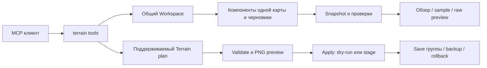

# TERRAIN: устройство и работа модуля

TERRAIN объединяет редактирование поддерживаемой поверхности и диагностику native-компонентов карты. Он живёт в `src/modules/terrain/`, подключён к общему MCP-серверу и использует `Workspace` с теми же черновиками, SHA-проверками и транзакциями, что Data/Map/Placement.

Добавление из `SC2_Surface_Toolkit_SC2GameData.zip` находится в `src/modules/terrain/surface/`. Оно расширяет существующий TERRAIN десятью инструментами `terrain.surface.*`. Отдельный сервер и второй набор workspace-файлов не создаются.

19 октября подключены недостающие публичные инструменты ModKit: маски проходимости и заливка, raw pathing/creep, fluff, значения vertex-color, native HRDT, палитры и перенос/расширение квалифицированных рамп. `terrain.navigation.preview` использует эффективные footprint объектов из Data/CASC и сохраняет PNG. Массовый декор и привязка к высоте доступны как `terrain.decorate` и `terrain.objects.snap` через наш Placement. Подробная таблица, примеры и ограничения: [интеграция ModKit](MODKIT_INTEGRATION_RU.md#расширение-terrain--19-октября).

## Основные команды создания поверхности

| Задача | Команда для Codex |
| --- | --- |
| Создать рельеф и распределить материалы | `terrain.generate`, `terrain.landscape.plan` |
| Покрасить выбранной текстурой | `terrain.paint` |
| Смешать текстуры | `terrain.blend`; default strength 0.5 сохраняет долю прежней текстуры |
| Горки, неровности, выравнивание и сглаживание | `terrain.mountain`, `terrain.valley`, `terrain.plan` с `height.raise/lower/noise/smooth/flatten/slope` |
| Скрыть грунт клетками или областью | `terrain.hide` |
| Восстановить грунт | `terrain.show` |
| Посмотреть скрытые клетки | `terrain.visibility.inspect`, `terrain.preview` с `mode:"visibility"` |
| Нарисовать/стереть запрет прохода или строительства | `terrain.pathing.paint`, `terrain.pathing.fill` |
| Проверить статическую проходимость и получить PNG | `terrain.navigation.preview` |
| Рассеять декор по фильтрам / привязать объекты к рельефу | `terrain.decorate`, `terrain.objects.snap` |
| Подобрать/перенести native ramp из донора | `terrain.ramp.fit`, операция `ramp.template` в `terrain.modkit.plan_file` |

Эти команды создают настоящий сохраняемый Terrain plan. `terrain.apply` с `dryRun:false, stage:true` и `terrain.save` с `dryRun:false` записывают изменения. У `save` тоже есть dry-run по умолчанию.

### Скрытие грунта

Это отверстия/чёрные участки на карте. На предоставленной `p.SC2Map` из Editor 5.0.17.98310 обнаружены 24 клетки с флагом `0x06`; обычный грунт имеет `0x02`, отверстия под cliff meshes — `0x03`. Кисть изменяет только скрывающий бит `0x04` в `t3CellFlags` v102 и сохраняет остальные биты, высоту, texture weights и cliff/ramp geometry.

```json
{"tool":"terrain.hide","arguments":{"cells":[{"x":72,"y":62},{"x":73,"y":62}]}}
{"tool":"terrain.show","arguments":{"area":{"type":"rectangle","minX":72,"minY":62,"maxX":76,"maxY":66}}}
```

`cells` — целые native cell indices; `area` — world-space область с выбором по центрам клеток. Требуется ровно один из этих вариантов. Реализация ограничена размерно согласованным LFCT v102; непроверенные версии отказывают явно. Операции доступны и в `terrain.plan` как `surface.hide`/`surface.show`. В GUI добавлены Hide/Restore ground, Blend textures, Uneven ground и preview скрытия.

После скрытия ground sampling показывает `hidden:true`; scatter и snap не размещают объекты на скрытом грунте. Клифовые модели и объекты остаются отдельной геометрией. Проходимость и navigation mesh этой кистью не пересчитываются.

2026-10-11: пользователь визуально проверил и подтвердил работу двух MCP-authored packed копий `p.SC2Map`: восстановление 24 клеток и добавление 16 скрытых клеток. Это пользовательская визуальная проверка этого сценария, а не автоматическое доказательство всего Editor/runtime. MPQ reopen проверяет каждый entry; десять регрессий включают настоящие MCP paint/blend/height-noise/hide/show → stage/save.

## Из чего состоит

| Часть | Файлы | Задача |
| --- | --- | --- |
| Существующий Terrain | `document.ts`, `operations.ts`, `workspace.ts` | Декодирование поддерживаемых версий, создание плана, синхронизация разрешённых изменений, stage/save/rollback |
| Рецепты | `recipes.ts`, `xmlRecipe.ts`, `geometry.ts` | Seeded ландшафты, области, кисти и строгий XML DSL |
| Вода и свет | `waterCatalog.ts`, `lighting.ts` | Ограниченные native-профили WATR/CWater и CTerrain/CLight |
| Preview | `preview.ts` | Диагностический PNG по плану |
| Surface Toolkit | `surface/format/`, `surface/core/` | Исходные кодеки, snapshot, raw samples, structural checks, pure byte previews и каталоговые связи |
| Host-адаптер | `surface/workspace.ts` | Одна выбранная карта, чтение disk/draft через общий Workspace, проверка повторного чтения |
| MCP | `tools.ts`, `surface/tools.ts` | Схемы входов, регистрация, ограничения ответов и tool errors |



## Что уже работает

| Возможность | Результат |
| --- | --- |
| Обзор | Размеры, версии, компоненты, counts, статусы parsed/partial/opaque/ambiguous/invalid |
| Высота | Существующие world-space инструменты и отдельные raw HMAP base/adjustment/mask samples |
| Текстуры | Прямые paint/blend commands, палитра и кисти; raw MASK возвращает восемь весов 0..15 |
| Рельеф | Raise/lower/set/flatten/noise/smooth, ограниченные seeded стили и feature recipes |
| Вода | Существующие flat v110 rectangles на сетке 8 клеток и CWater states; сложные bodies сохраняются без редактирования |
| Свет | Существующие binding CTerrain и поддерживаемые CLight поля |
| Placement | Scatter, привязка объектов к грунту и совместный план поверхности/объектов |
| Native-анализ | Cliff/ramp metadata, HRDT/VTCL/envelope inspection и raw bytes с явными неизвестными |
| Каталоги | Authored XML records, parent, processing instructions `<?token ...?>`, ссылки, sparse CliffHeights, символьные HeightCodes |
| Сохранение | Только существующий поддерживаемый Terrain plan: stale guards, групповая запись, backup и rollback |

Диагностика доступна даже там, где существующий Terrain writer отказывает из-за неизвестной версии. Возможность прочитать raw bytes не означает разрешение записать произвольный формат.

## Новые команды

У команд поверхности `directory` — путь одной карты относительно `SC2_UI_ROOT`; пустая строка выбирает корень. Обход вложенных папок карт не выполняется. `component` — имя файла из inventory этой карты.

| Команда | Вход и назначение |
| --- | --- |
| `terrain.surface.overview` | `directory`, `maxChars` 128..12000; компактный обзор |
| `terrain.surface.components` | `offset`, `limit` 1..50; страницы списка компонентов |
| `terrain.surface.component.inspect` | `component`, опциональная `section`, `offset`, `limit` 1..20 |
| `terrain.surface.height.sample` | Целые `x`,`y` в HMAP grid; raw и две кандидатные формулы world Z |
| `terrain.surface.texture.sample` | Целые `x`,`y` в MASK pixel grid; восемь nibble-весов |
| `terrain.surface.paint.sample` | `layer: pathing/creep`, целые физические `x`,`y` в сетке 512×512 |
| `terrain.surface.bytes` | `component`, `offset`, `length` 0..4096; ограниченный hex-фрагмент |
| `terrain.surface.validate` | Структурные и ограниченные межслойные проверки |
| `terrain.surface.plan.cell` | Одна raw/parameter правка в памяти, changed ranges и dirty dependencies |
| `terrain.surface.catalog.inspect` | Workspace-relative `file`, фильтры `id`/`type`, страницы и явные `bindings` для single-pass token preview |

Все десять команд имеют `readOnlyHint:true`. Ошибки возвращаются как `isError:true`. Ответ ограничен 32000 символами; переполнение даёт `OUTPUT_BUDGET`. Малый обзор помечается `TRUNCATED`. Символы не объявляются модельными токенами.

Snapshot содержит SHA-256 revision, выбранную папку и список staged files. Перед ответом повторно проверяются наблюдавшиеся файлы и inventory. Изменение даёт `SURFACE_CHANGED_DURING_READ`. Absolute paths, traversal, symlink-пути и case collisions отклоняются; действуют лимиты числа файлов и байтов. Это проверка наблюдавшегося read set, а не блокировка внешних процессов от дальнейших изменений.

## Примеры чтения

```json
{"tool":"terrain.surface.overview","arguments":{"directory":"maps/Test","maxChars":6000}}
{"tool":"terrain.surface.component.inspect","arguments":{"directory":"maps/Test","component":"t3Terrain.xml","section":"ramps","limit":5}}
{"tool":"terrain.surface.height.sample","arguments":{"directory":"maps/Test","x":12,"y":8}}
{"tool":"terrain.surface.paint.sample","arguments":{"directory":"maps/Test","layer":"pathing","x":12,"y":8}}
```

`height.sample` здесь использует индексы вершин; `terrain.sample` существующего API использует world coordinates. MASK pixels и physical painted grid тоже имеют отдельные домены.

```json
{"tool":"terrain.surface.plan.cell","arguments":{"directory":"maps/Test","edit":{"kind":"height-raw","channel":"heightAdjustments","x":12,"y":8,"value":512}}}
```

Preview содержит изменённые byte ranges, `dirtyDependencies`, `requiresEditorRoundTrip:true` и `engineValidated:false`. Он не stage-ит данные, не создаёт `planId` и не передаётся в `terrain.apply`. Пять видов: `height-raw`, `texture-weight`, `painted-raw`, `vertex-byte`, `terrain-parameter`.

## Как выполняется поддерживаемая запись

1. Выбрать карту и прочитать `terrain.inspect`, `terrain.capabilities`, палитру и нужные samples.
2. Составить `terrain.plan`, `terrain.generate`, `terrain.road`/`terrain.river`/`terrain.lake` и другие feature tools, `terrain.recipe.plan`, `terrain.water.plan` или lighting plan.
3. Проверить возвращённый `planId`, ограничения, diff и `terrain.preview`/`terrain.validate`.
4. Вызвать `terrain.apply` сначала с `dryRun:true`; для stage — явно `dryRun:false, stage:true`.
5. Сохранить через `terrain.save` или `modkit.save` всю группу; отменить через discard, восстановить сохранённый результат через доступный rollback.

Точная схема apply/save: [Terrain API](TERRAIN_MCP.md). Height writers требуют поддерживаемых sync-данных и unit scale; native geometry защищена. Toolkit не меняет этот профиль и не вводит прямую файловую запись.

## GameData и происхождение

Каталоговая инспекция читает фактические XML-байты рабочего проекта, указывает путь и SHA-256, сохраняет `<?token ...?>` и исходные значения. Пример:

```json
{"tool":"terrain.surface.catalog.inspect","arguments":{"file":"maps/Test/Base.SC2Data/GameData/CliffMeshData.xml","id":"CliffNatural0","bindings":{"id":"CliffNatural0"},"limit":5}}
```

Поддерживаемые связи для анализа: Terrain → TerrainTex → DDS/PhysicsMaterial/foliage; Terrain → Cliff → CliffMesh; Terrain → Tile → hardTile.bin/M3; CWater → shoreline Model. `bindings` задаёт владелец запроса; подстановка делается один раз, исходное значение сохраняется, неизвестные токены остаются unresolved.

Инструмент не объединяет inheritance/defaults/dependency overrides, не подтверждает наличие assets и не открывает CASC. Named defaults, отсутствующие индексы, пустые значения и нули сохраняют различия. HeightCodes остаются буквенными строками; отображение букв в высоту и ориентация неизвестны.

Для ограниченного отчёта по уже извлечённым XML:

```powershell
npm run build
npm run terrain:catalog:scan -- --root "K:\ExtractedGameData" --out "K:\Reports\terrain-catalogs.json"
```

Scanner не перезаписывает output, сообщает ошибки/пропуски, не следует symlinks и не является CASC extractor. 35 наблюдений SC2GameData из архива используются только как reconstructed regression excerpts; это не текущий полный дамп игры. [Происхождение исходников](../src/modules/terrain/surface/NOTICE.md).

## Неизвестные форматы и дальнейшая работа

- HMAP при `scaleZ != 1`: формулы из reviewed sources расходятся; `worldZ:null` и кандидаты показывают конфликт.
- SMAP v102: Toolkit не выбирает planar/interleaved по эвристике и возвращает ambiguous без явного профиля. Существующий Terrain writer сохраняет свой ограниченный корпусный профиль.
- WATR bodies/shorelines/waves и HRDT string framing/mesh generation не превращаются в общий writer.
- Painted bytes, CellFlags и CellAttribute не равны конечной проходимости; `passable:null` остаётся явным.
- Читатели `terrain.surface.*` сами не создают cliffs/ramps и не перестраивают engine pathing. Запись выполняют существующие `terrain.cliff.*`/`terrain.ramp.*` и новый ModKit `ramp.template` в пределах своих профилей. Проверка игрового runtime остаётся отдельной.

Следующие этапы: собрать карты до/после одиночных операций в нужной сборке Editor; зафиксировать byte SHA/build; подтвердить спорные profiles; разрешать writer только для согласованной группы слоёв через существующие транзакции. Каждый такой этап требует своего подтверждённого результата; нынешние tests не считаются engine certificate.

## Проверки

`npm test` включает 166 перенесённых codec/catalog/surface regressions и host/SDK integration tests. Они проверяют отрицательные входы, byte preservation, token metadata, staged views, разделение карт, stale reads, preview без записи, лимиты и регистрацию по профилям. Три старых теста отдельного CLI/21 wrapper adapters не переносились: эти дублирующие wrappers не включены в сервер; новый host и SDK проверяются напрямую.

`npm run terrain:schemas` генерирует актуальные схемы, включая десять новых инструментов. `npm run lint` и `npm run build:release` проверяют интеграцию. Windows portable package включает XML-парсер; открытие карты в SC2 Editor и игровая проверка остаются отдельными невыполненными этапами.
